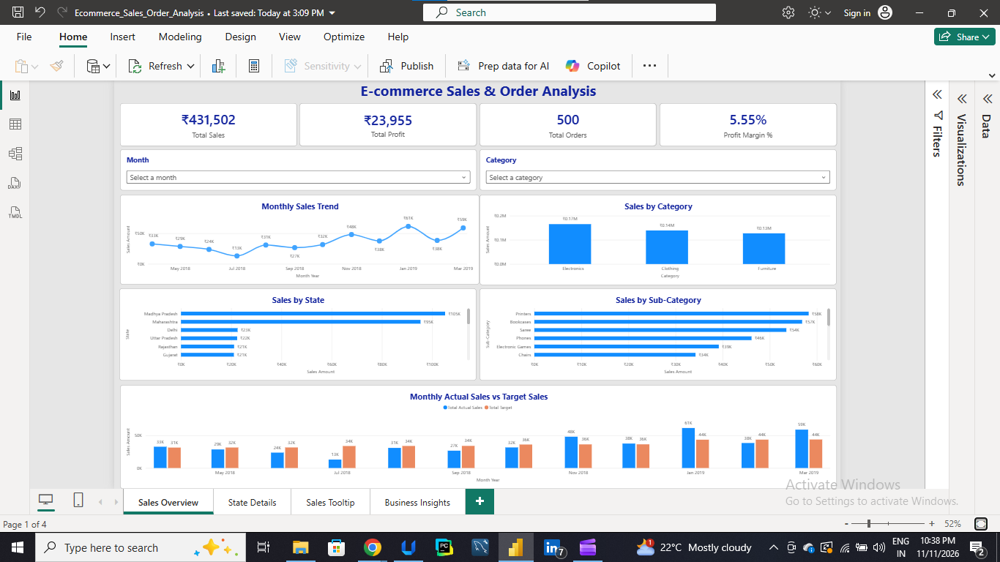
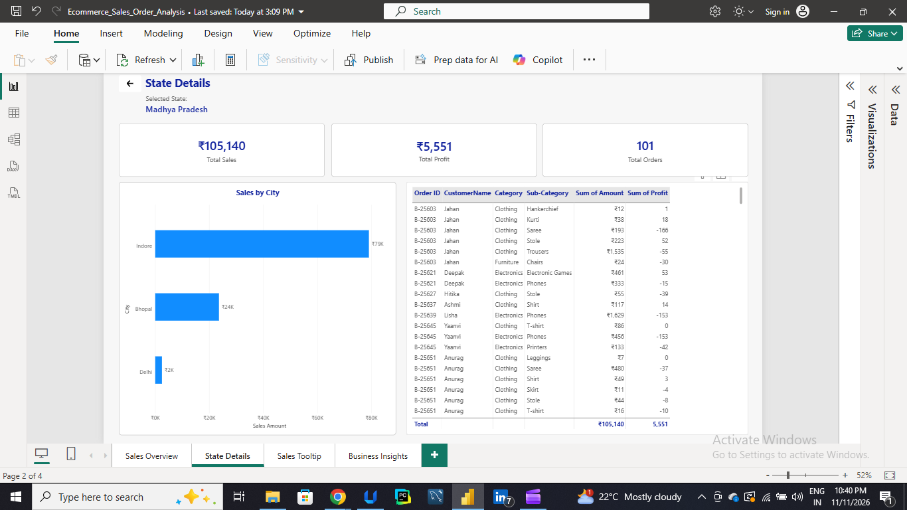
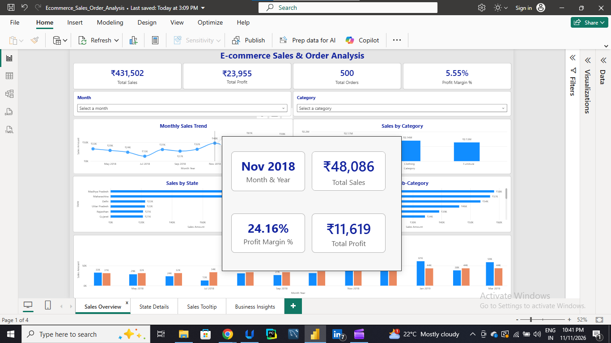
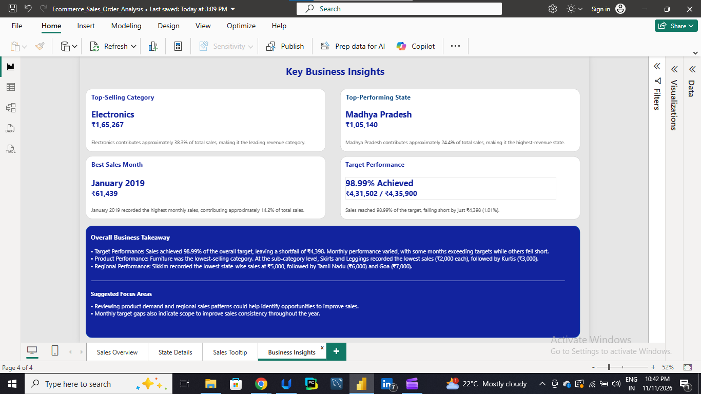

# E-commerce Sales & Order Analysis | Power BI

## About the Project

I created this Power BI project to explore e-commerce sales data and understand how sales and profits vary across different categories, states and months.

The dashboard brings together key performance numbers and interactive visuals to make it easier to explore the data, compare performance and identify areas that need attention.

## Tools Used

- **Power BI Desktop** – Dashboard creation and data visualization
- **Power Query** – Data cleaning and transformation
- **DAX** – Measures and calculations
- **CSV files** – Source data

## Dashboard Preview

### 1. Sales Overview

The main dashboard provides an overview of sales performance through KPI cards, monthly sales trends and category-wise and state-wise analysis. Month and Category slicers allow users to explore the data interactively.

### 2. State Details

This page provides a closer look at state-level performance. I used drill-through functionality to navigate from the overview to individual state details.

### 3. Sales Tooltip

I created a report-page tooltip to display additional sales and profit information when hovering over the monthly sales trend.

### 4. Business Insights

This page brings together the key observations from the analysis, highlighting performance across different categories, states and months, along with areas that may need improvement.

## Features

- Interactive Month and Category slicers
- KPI cards for key performance indicators
- Monthly sales trend analysis
- Sales and profit analysis
- State-wise and category-wise comparisons
- Drill-through navigation
- Custom report-page tooltip
- Sales target comparison

## Dataset

The analysis uses three datasets:

- List of Orders
- Order Details
- Sales Target

**Source:** [E-Commerce Data – Kaggle](https://www.kaggle.com/datasets/benroshan/ecommerce-data)

**Dataset License:** CC0 – Public Domain

## Project Demonstration

[Watch the dashboard walkthrough](https://1drv.ms/v/c/fad0e1c62a2b887f/IQCtFsgHZBeZQrWplrW4hNEUAVBTlpjGlDNL_fXXikZ8OX4?e=vem8P5)

## Project Files

- `power bi/` – Power BI report file (.pbix)
- `source files/` – Original CSV datasets
- `screenshots/` – Dashboard screenshots

## License

This project is licensed under the MIT License. Refer to the LICENSE file for details.

---

*Created as part of my learning journey in Data Analytics.*
